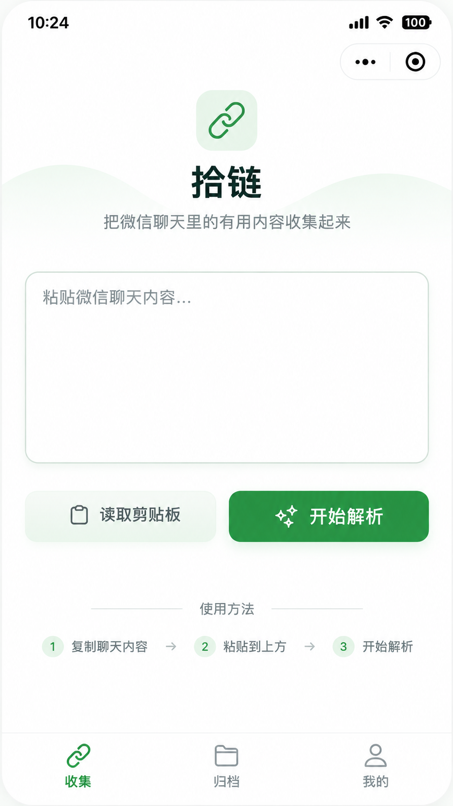
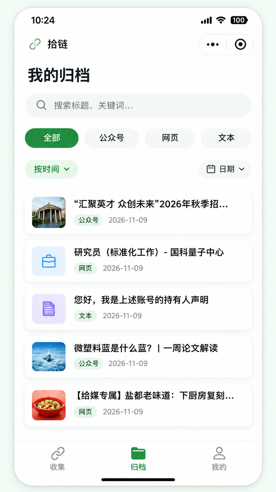
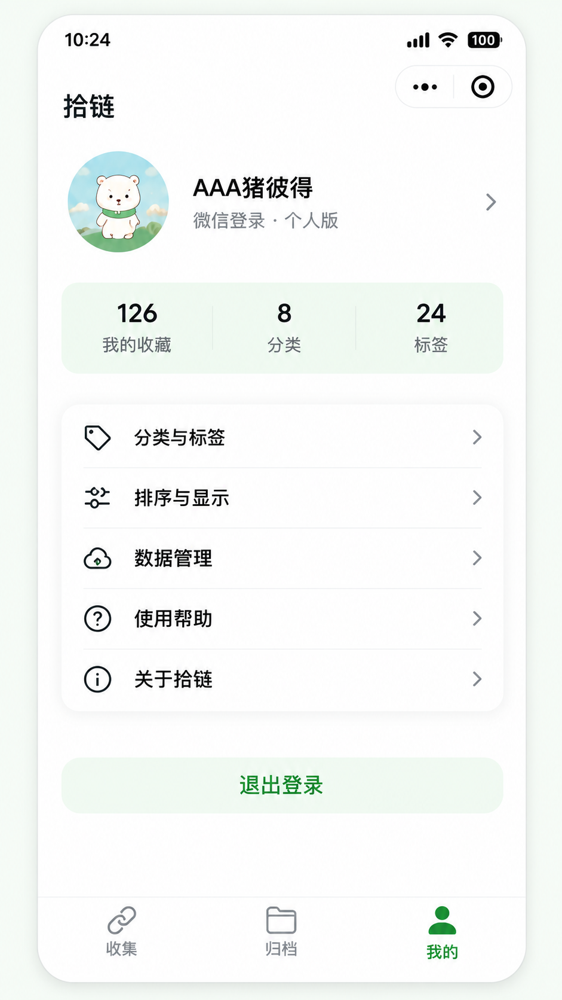

# 拾链 LinkMemo

把微信聊天中值得保留的链接、公众号文章和文字内容，快速收集并长期整理。

微信原生小程序 + CloudBase 云开发实现。默认提供**本地模式**，无需云环境即可完整体验收集、解析、归档、分类标签、检索、编辑、回收站、我的与帮助流程。底部导航使用自定义 tabBar，图标与文字字号已放大。

仓库：<https://github.com/pigz2538/LinkMemo>

## 界面

| 收集 | 归档 | 我的 |
| --- | --- | --- |
|  |  |  |

## 功能

### 收集

- 多行粘贴，实时字符计数，单次上限 30,000 字符
- 仅在用户主动点击时读取剪贴板（`wx.getClipboardData`）
- 按「发送人 + 日期时间 + 正文」拆分多条微信消息，无法识别时按空行/URL 降级拆分
- 解析进度、可取消；结果展示成功 / 重复 / 失败数量与明细
- 重复内容默认跳过，可切换「仍然保存」
- 解析失败或网页抓取失败仍保留原始文本 / URL

### 解析引擎

- URL 提取与首尾标点清理，支持成对括号（如维基百科链接），自动去除包裹链接的多余括号
- 内容类型：公众号、网页、文本、小程序、文件线索、图片线索、其他
- 兼容常见复制时间格式：完整日期、`/`、`-`、省略年份、`昨天`、`星期X`、`上午/下午/晚上`、带秒
- 单条消息包含多个 URL 时拆成多条记录；公众号使用精确域名匹配，避免 `mp.weixin.qq.com.evil.com` 之类伪造域名误判
- 标题优先级：`[链接]` 分享标题 > `jobTitle` 参数 > 聊天关联文本 > 网页元信息 > 域名/类型兜底
- 文本默认取前 30 字作为标题，完整原文保存在 `content`
- 文件 / 图片 / 小程序线索只保存可见文本，不读取二进制
- 去重键：URL 规范化（移除 `utm_*`、`from`、`scene`、`xtrack`、`chksm` 等追踪参数与 fragment，保留业务参数）；无 URL 文本使用内容哈希
- 中文标题拼音首字母（内置 2 万余字映射，数字/特殊字符归入 `#`）

### 归档

- 关键词搜索：标题、域名、URL、摘要、备注、原始文本
- 内容类型筛选
- 时间正反序、标题拼音 A-Z / Z-A
- 日期：今天、近 7 天、近 30 天、自定义范围
- 自定义分类、标签、发送者组合筛选；多标签支持「同时满足 / 任一满足」
- 首屏 20 条，滚动加载更多，筛选变化重置分页
- 多选批量删除、批量分类、批量添加/移除标签
- 长按卡片进入多选

### 记录管理

- 详情：类型、标题、摘要、链接、正文、分类、标签、收录时间、原始消息
- 编辑：标题、URL、备注、内容类型、分类、标签；支持在编辑页快速新建分类/标签
- 复制原始链接、标题或正文
- 打开链接：已配置业务域名走 `web-view`，否则复制链接并提示
- 软删除进入回收站，支持恢复、永久删除、清空回收站

### 分类与标签

- 新建、重命名、改色、删除
- 分类 / 标签使用数量
- 删除分类：记录变为「未分类」，不删除记录
- 删除标签：仅解除关联
- 同一用户下名称唯一

### 我的与帮助

- 微信登录状态、脱敏账号标识、收藏 / 分类 / 标签统计
- 默认排序设置
- 隐私说明入口
- 数据导出（JSON 复制到剪贴板）、回收站、清空回收站、删除账号数据
- 帮助：三步教程、可识别示例、限制说明、7 条 FAQ、复制反馈模板
- 退出登录

## 技术架构

```
miniprogram/                 微信原生小程序
  app.json / app.wxss        全局配置与主题
  config.js                  本地/云端模式开关
  components/                nav-bar、empty-state
  pages/                     收集、归档、我的、详情、编辑、分类标签、帮助、回收站、web-view
  utils/
    parser.js                解析引擎（前端与云函数共用）
    pinyin*.js               中文首字母
    local-api.js             本地 Storage 数据层（首次启动为空库）
    cloud-api.js             CloudBase 调用封装
    api.js                   模式切换
    format.js                类型元信息与展示装饰
    layout.js                安全区/胶囊导航计算
    settings.js              默认排序设置
cloudfunctions/api/          CloudBase 云函数
  index.js                   action 路由、鉴权、CRUD
  lib/parser.js              同步后的解析引擎
  lib/fetcher.js             axios + cheerio 网页元信息抓取（SSRF 防护）
tests/                       解析器与本地数据层测试
scripts/                     图标生成、共享库同步
```

### 本地模式（默认）

`miniprogram/config.js`：

```js
module.exports = {
  cloudEnabled: false,
  cloudEnv: ''
}
```

数据保存在微信本地 Storage（`linkmemo_db_v2`）。首次启动为空库，不包含任何演示归档、分类或标签；旧版 `linkmemo_db_v1` 的演示数据不会被读取。

### 云开发模式

1. 微信开发者工具中开通云开发，记录环境 ID。
2. 修改 `miniprogram/config.js`：

```js
module.exports = {
  cloudEnabled: true,
  cloudEnv: 'your-env-id'
}
```

3. 右键 `cloudfunctions/api` → **上传并部署：云端安装依赖**。
4. 建议在云开发控制台把 `api` 云函数超时时间设置为 **20 秒**（网页元信息抓取使用独立 `enrichArchive` 调用，保存动作不会被抓取阻断）。
5. 在云开发控制台创建集合：

| 集合 | 说明 |
| --- | --- |
| `users` | 用户账户，`openid` 唯一 |
| `archive_items` | 归档主体，所有查询带 `user_id` |
| `user_categories` | 自定义分类 |
| `user_tags` | 自定义标签 |
| `parse_batches` | 导入批次统计，不保存整段剪贴板原文 |

6. 数据库权限建议设为「仅创建者可读写」，实际读写均通过云函数校验 `openid`。
7. 建议索引：

- `users.openid` 唯一
- `archive_items`: `user_id + saved_at`
- `archive_items`: `user_id + content_type + saved_at`
- `archive_items`: `user_id + title_bucket`
- `user_categories`: `user_id + name` 唯一
- `user_tags`: `user_id + name` 唯一

### 云函数接口（action）

`login`、`parseAndSave`、`enrichArchive`、`getArchiveList`、`getArchiveDetail`、`updateArchive`、`batchUpdateArchive`、`batchTag`、`deleteArchive`、`restoreArchive`、`emptyRecycleBin`、`getCategories`、`getTags`、`getSenders`、`manageCategory`、`manageTag`、`getProfileStats`、`exportData`、`clearUserData`。

`parseAndSave` 先完成归档落库并返回 `pending_enrich_ids`，前端随后异步调用 `enrichArchive` 抓取网页元信息，抓取失败或超时不影响已保存内容。

所有业务接口的用户身份来自 `cloud.getWXContext().OPENID`，前端不传 `user_id`。

## 网页抓取安全

`cloudfunctions/api/lib/fetcher.js` 实现：

- 仅允许 HTTP / HTTPS
- 禁止 `localhost`、私网 IP、环回、链路本地、CGNAT、组播、保留地址、云元数据地址
- 域名解析后校验全部 A/AAAA 记录；自定义 `lookup` 在连接时再次校验，降低 DNS rebinding 风险
- 最多 3 次重定向，每次重新校验目标 IP
- 超时 2.5s、响应体上限 512KB、并发 3、单次最多抓取 3 个网页
- 禁用压缩，仅提取 `og:title`、HTML title、description 和有限正文片段
- 不发送微信 Cookie 或其他会话凭证
- 抓取失败不阻断归档，原始链接与文本照常保存

### 解析器是否过拟合样例

- 解析器源码不包含样例标题、URL、发送人等样例特定内容；`tests/no-hardcoding.test.js` 会扫描源码并阻止这类回归。
- 运行时不含任何演示数据；测试使用的消息 fixture 只在 `tests/` 中生成，不会进入小程序包或云函数。
- 解析规则只保留 PRD 明确要求的常量：微信文章域名、`[链接]/[文件]/[图片]/[小程序]` 等消息标记、`jobTitle` 参数、常见追踪参数。
- 测试额外覆盖了真实样例之外的场景：多种日期格式、无消息头降级、单条多 URL、伪造微信域名、非法日期、空输入、其他消息标记等。

## 测试

```bash
npm test
```

等价于：

```bash
node tests/parser.test.js
node tests/fuzz.test.js
node tests/local-api.test.js
node tests/cloud-api.test.js
node tests/cloud-security.test.js
node tests/no-hardcoding.test.js
```

云函数相关测试需要先安装云函数依赖；未安装时会自动跳过：

```bash
npm install --prefix cloudfunctions/api
```

- 解析器 22 组测试：消息拆分、各种日期格式、无消息头降级拆分、多 URL、URL 标点与成对括号、公众号精确域名、`jobTitle`、文本/文件/图片/小程序/聊天记录线索、去重规范化、拼音首字母、空输入、非法日期
- 模糊测试：1200 组随机混合消息（不同发送人、日期、URL、标记、多行文本、emoji、超长文本）不抛异常，字段类型与内容类型始终合法；500 组 URL 规范化/域名提取稳定性检查
- 本地数据层：空库启动、登录/退出会话、分页、搜索/类型/分类/标签 AND-OR/发送者/日期筛选、时间与标题排序、分类标签 CRUD 与大小写唯一性、URL 类型纠正、去重与允许重复、回收站、批量操作、导出、清空
- 云函数账号隔离测试：用内存数据库 Mock 两个及三个不同 `OPENID`，验证登录不泄露 openid、跨账号读取/修改/删除/批量操作被拒绝、每用户独立去重、分类/标签/发送者隔离、统计与导出只含本人、账号数据删除只影响本人、元信息抓取失败兜底
- `no-hardcoding.test.js`：扫描解析器源码，确保没有写入样例标题、URL、发送人等样例特定内容；同时校验前端与云函数解析器副本一致
- 本地存在 `链接样例.txt` 时会额外解析真实聊天样例（70 条消息，覆盖公众号/网页/文本/文件/图片/小程序）
- `链接样例.txt` 含个人信息，已加入 `.gitignore`，不随仓库上传
- GitHub Actions（`.github/workflows/test.yml`）会在每次 push / PR 时安装云函数依赖并运行全部测试

修改 `miniprogram/utils` 下的解析/拼音/格式模块后，同步到云函数：

```bash
npm run sync:cloud
```

## 验收对照

| 编号 | 验收项 | 实现 |
| --- | --- | --- |
| AC-01 | 登录与隔离 | 云函数以 `OPENID` 解析用户，所有集合查询带 `user_id` |
| AC-02 | 批量粘贴 | 消息边界拆分 + 空行/URL 降级拆分 |
| AC-03 | 公众号识别 | `mp.weixin.qq.com` 识别，优先保留分享标题 |
| AC-04 | 网页提取 | 云函数 `axios + cheerio` 抓取；失败保存原 URL |
| AC-05 | 文本与线索 | 文本、文件、图片、小程序线索均可保存 |
| AC-06 | 编辑删除 | 编辑标题/链接/分类/标签；软删除进入回收站 |
| AC-07 | 分类标签 | 新建、重命名、改色、删除；删除分类不删记录 |
| AC-08 | 搜索筛选 | 关键词 + 类型 + 分类/标签 + 发送者 + 日期组合 |
| AC-09 | 排序 | 时间正反序、标题拼音 A-Z / Z-A |
| AC-10 | 帮助 | 教程、示例、限制、FAQ、反馈模板 |

## 说明与边界

- 产品界面按提供的三张设计稿实现为 **收集 / 归档 / 我的** 三个底部入口；PRD 中的「分类」「帮助」作为二级页面从「我的」进入，避免底部导航过重。
- 小程序不读取微信聊天记录，只处理用户主动粘贴或读取的剪贴板文本。
- 文件、图片、小程序线索只保存可见文本，不代表文件本体已上传。
- 不承诺所有外部网页都能在小程序内打开；未配置业务域名时会复制链接。
- 数据导出当前以 JSON 文本复制到剪贴板，后续可扩展为云存储文件下载。
- 网页抓取能力取决于 CloudBase 云函数的网络访问与套餐规则，上线前请以控制台当前规则为准。

## 开发参考

- [微信小程序官方开发文档](https://developers.weixin.qq.com/miniprogram/dev/framework/)
- [微信云开发文档](https://developers.weixin.qq.com/miniprogram/dev/wxcloudservice/wxcloud/)
- [wechat-miniprogram-toolkit](https://github.com/moniq888/wechat-miniprogram-toolkit)（MIT，开发时安装并参考其项目初始化、云开发与鉴权规范）
- [Remix Icon](https://github.com/Remix-Design/RemixIcon)（图标资源）

## License

代码可自由用于学习与二次开发。图标资源基于 Remix Icon 生成，许可证见 `scripts/remixicon.LICENSE`。
